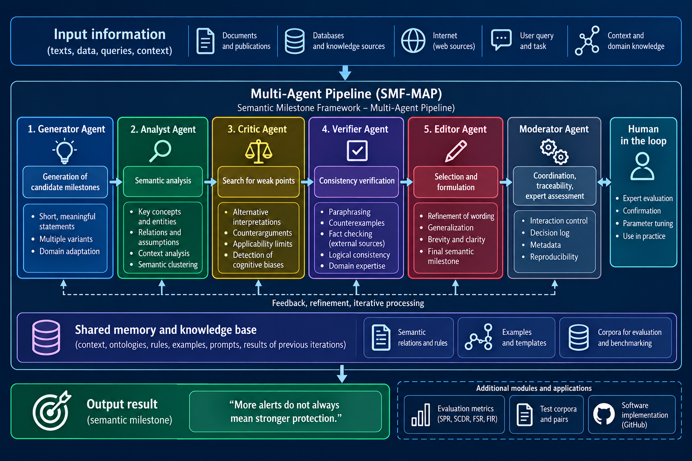
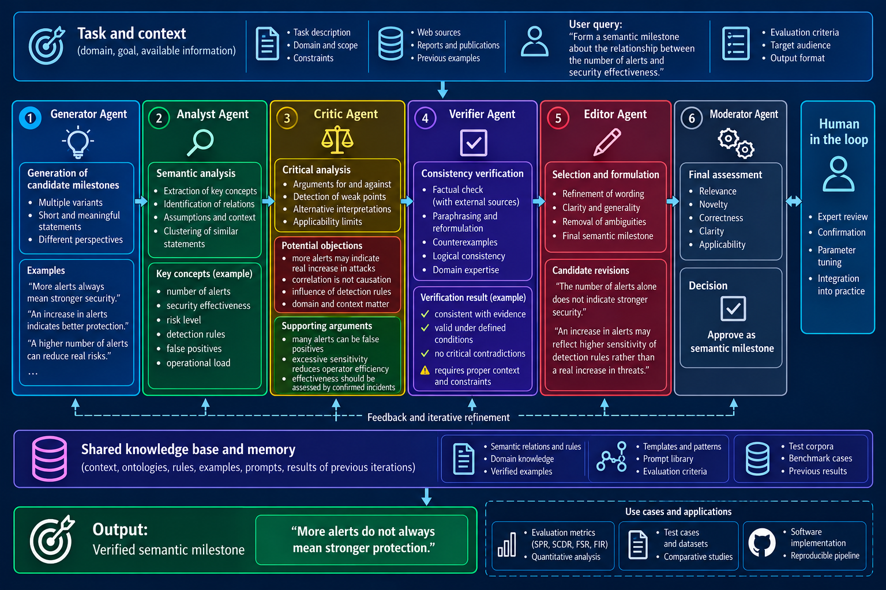

# Semantic Milestones (SMF-MAP)

**From texts to meaningful, verifiable insights.**

**SMF-MAP** (*Semantic Milestone Framework – Multi-Agent Pipeline*) is a framework for generating, analyzing, critically examining, and verifying **semantic milestones**: short, self-contained, meaningful propositions that express observations, conditional predictions, or principles for action.


## Framework and research article

- **[SMF-MAP framework — English, v1.1](Framework/SMF_MAP_v1_1.md)** — multi-agent specification, workflow, roles, and prompts.
- **[Research article — *Semantic Milestones and the SMF-MAP Multi-Agent Framework* (DOCX)](Article/SMF_MAP_Art_ENG.docx)** — conceptual model, nine-class operational taxonomy, illustrative scenarios, and methodological audit.

## What is a semantic milestone?

A semantic milestone is a concise proposition that captures a meaningful insight without concealing the context needed to interpret or verify it. The target length is **up to ten words**, subject to preserving accuracy and necessary qualifications.

Examples:

> **More alerts do not always mean stronger protection.**
>
> **Local correctness does not guarantee collective consistency.**
>
> **The number of voices does not equal evidence independence.**

SMF-MAP distinguishes **observational (O)**, **predictive (P)**, and **actionable (A)** milestones. A milestone can be accompanied by context, evidence, quality attributes, implications, and temporal information.

## Architecture

The pipeline assigns specialized functional roles to the **Generator**, **Analyst**, **Critic**, **Verifier**, **Editor**, and **Moderator**, with shared knowledge, iterative feedback, and **Human in the Loop** review. Agent roles describe a conceptual workflow; they do not, by themselves, imply independent model execution.



## Example: from information to a verified milestone

The diagram below illustrates a cybersecurity monitoring scenario: an increase in alerts does not, on its own, demonstrate improved protection. Candidate formulations are examined, challenged, verified within available evidence, and refined.



## Semantic relationship taxonomy

SMF-MAP distinguishes nine basic relationship classes:

| Class | Meaning |
|---|---|
| `CONTRADICTION` | Statements cannot both be true under the same conditions |
| `COUNTEREXAMPLE` | A specific case refutes a universal statement |
| `EQUIVALENCE` | Bidirectional logical entailment |
| `ENTAILMENT` | Directional logical entailment (`A_TO_B` or `B_TO_A`) |
| `CONTEXT_DEPENDENT` | An apparent discrepancy is explained by differing contexts |
| `TRADE_OFF` | A necessary choice under a shared resource constraint |
| `TENSION` | Opposing tendencies without a demonstrated necessary trade-off |
| `COMPLEMENT` | Compatible propositions describe complementary aspects |
| `UNRELATED` | No significant relationship is established in the given context |

`NEEDS_CONTEXT` is an **abstention outcome**, not a tenth relationship class.

## Research status and limitations

The accompanying article presents a **single-session model-based methodological audit** using author-constructed statement pairs and controlled modifications. Its numerical results **must not** be interpreted as independently measured classification accuracy or proof of the effectiveness of a fully orchestrated multi-agent system. Independent agent runs, blinded expert evaluation, and controlled comparisons remain future research tasks.

## Repository layout

```text
PIC/         Three diagrams and project illustration
Framework/   English SMF-MAP v1.1 and Ukrainian SMF v1.2 specifications
Article/     English research article (DOCX)
README.md    Project overview and navigation
```

## Author

**Dmytro Lande**  
National Technical University of Ukraine “Igor Sikorsky Kyiv Polytechnic Institute”

For the scientific description and methodological limitations, please refer to the [research article](Article/SMF_MAP_Art_ENG.docx).

## Reuse

This repository includes research text, framework specifications, and illustrations. **No blanket reuse license is asserted here.** Consult the applicable license or obtain the author's permission before reuse beyond statutory exceptions. A repository-wide license can be added separately if desired.
